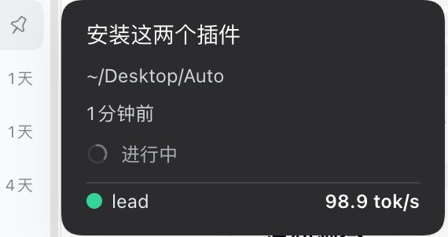
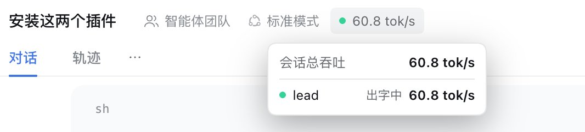
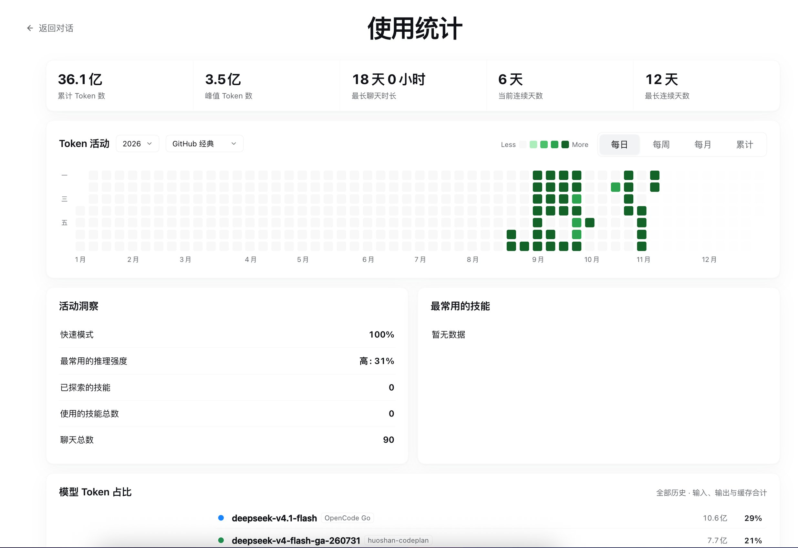

# dsh-token-board

[简体中文](README.md) | English

A realtime token board for DSH Web: instead of listing every session in a floating window, it puts throughput data right where you are looking; clicking the summary row at the bottom of the sidebar opens the full "Usage Stats" panel (token activity heatmap, activity insights, skill and model share).

| Where | What |
| --- | --- |
| Bottom of the sidebar, above the account row | Three green/blue/yellow bars (animating in turn while there is activity, static grey when idle) + summary "N sessions active, X tok/s"; when the sidebar is collapsed to a narrow rail only the icon remains, and hovering shows a summary popover |
| Bottom of the session-list hover card | Realtime tok/s of the session's active primary agent and subagents, each preceded by a solid status dot |
| End of the conversation header action area (right of "N background tasks") | **Overall throughput** of the currently open session (primary agent + all subagents); hover to expand the full per-agent breakdown (paused or 0 still counted) |
| Clicking the bottom summary row | Opens the full "Usage Stats" panel: cumulative/peak tokens, longest conversation, streak days, token activity heatmap (optional year and color theme; themes come from the 8 schemes of calendar-heatmap design tokens; defaults to the full current year, future dates greyed out and not hoverable; daily/weekly/monthly/cumulative), activity insights, most-used skills, model token share (each model labelled with its provider); Chinese UI, adapts to light/dark |

The status dots follow the semantics of dsh-token-hud but use this plugin's own solid-color style (no outline, no glow):

| Status | Color |
| --- | --- |
| streaming | green `#34d399` |
| running (waiting for the model) | yellow `#facc15` |
| tool call | blue `#60a5fa` |
| retrying | orange `#fb923c` |
| idle | grey `#9aa0a6` |

## Screenshots: token speed in different scenarios

**Scenario 1: session-list hover card** — move the mouse over a session in the sidebar session list; the bottom of the card shows the realtime tok/s of that session's active primary agent and subagents individually (in the screenshot `lead` is 98.9 tok/s).



**Scenario 2: conversation header** — open a session and the end of the header action area (right of "N background tasks") shows the overall throughput of this session (primary agent + all subagents); hovering expands the per-agent breakdown (in the screenshot the session total is 60.8 tok/s and `lead` is streaming).



## Installation / deployment

Requirements: a DeepSeek Harness Web profile (developed and verified on `0.2.2-alpha.2`) and Node.js `^22.19.0 || >=24.0.0`.
The plugin has no npm dependencies, no build step and makes no external network requests; all data stays on the local machine.

**Option 1: install from a tarball (recommended for distribution)**

```sh
# after copying dsh-token-board-0.1.0.tgz to the target machine:
dsh plugin --profile web add /absolute/path/dsh-token-board-0.1.0.tgz
# restart dsh web (if the profile has HMR enabled it mounts automatically, otherwise it takes effect after a restart), then refresh the page
```

**Option 2: install from a directory (development/local link)**

```sh
dsh plugin --profile web add link:/absolute/path/dsh-token-board
```

**Option 3: Web UI**: install this directory or the tgz from Settings → Plugins.

After installation the summary row appears at the bottom of the sidebar, above the account row. Host read-only endpoints:

- `GET /token-board/v1/stats` — realtime per-agent throughput (polled internally)
- `GET /token-board/v1/usage?from&to&timeZone` — usage-stats snapshot (used by the panel)

The first time the stats panel is opened it builds a local index in the background (about 10 seconds for a large history; the panel never blocks — it shows partial data first and fills in automatically). The index file lives at `$DSH_HOME/token-board/usage-index.json` and can be deleted at any time to rebuild it.

Uninstall: `dsh plugin --profile web remove dsh-token-board`.

## Usage stats panel

Click the "N sessions active, X tok/s" summary row at the bottom of the sidebar (above the account row) to open the "Usage Stats" panel; "← Back to conversation" or Esc returns. The metrics and UI follow the "Usage Stats" page of [Zhang6177/dsh-token-usage-board](https://github.com/Zhang6177/dsh-token-usage-board) (only the overall stats UI is reproduced, without call details/export/filtering and other extras); data also comes from local session logs.

On the host side, `sessionQuery` reads session logs and caches a per-session summary in `$DSH_HOME/token-board/usage-index.json` (in-process refresh every 30s, incrementally reading only new sessions and the currently active ones). The endpoint uses stale-while-revalidate: opening the panel always returns the previous in-memory result first (millisecond-level), while indexing/refreshing happens entirely in the background and never blocks the page; while `indexReady:false` the panel short-polls to fill in. On a fresh install without cache it shows partial/empty data first and updates automatically once the background index (about 10 seconds) completes.
Read-only endpoint: `GET /token-board/v1/usage?from&to&timeZone`.

The full panel (sample data):



## Data sources

The host half listens to every session's `session/event` and (on newer hosts) the per-chunk `agent/assistant-stream` broadcast, estimates output speed from a rolling character window (Chinese ≈ 1 tok/char, English ≈ 4 chars/token) and corrects it to the exact value once an `assistant/message` carries provider usage. Subagents are attributed to their parent session through `parentSession` / `origin` / `delegationDepth` in the session header, and the header and hover card aggregate "itself + all descendants". Purely in-memory, zero persistence, no session-log writes.

## Configuration (optional, cordis.patch.yml)

> The client always polls `/token-board/v1/stats`; if you change `apiPath` you must also change `lib/client.js`, otherwise none of the three surfaces can fetch data.

```yaml
- id: token-board
  config:
    apiPath: /token-board/v1   # read-only endpoint prefix (fixed; the client hard-codes the same value)
    windowMs: 5000             # speed rolling window
    charsPerToken: 4           # characters per token for non-CJK text
    cjkTokensPerChar: 1        # tokens per CJK character
    idleTtlMs: 180000          # how long idle agents are retained
```

## Known limitations

- Speed is a streaming character estimate (roughly 10% error), corrected once the provider reports usage.
- Cumulative values reset when the host restarts; agents idle for longer than `idleTtlMs` disappear from the breakdown.
- Header throughput only applies to the open session; that position is hidden when no session is open.

## Tests

The tests depend on the jsdom/react from a DSH source checkout (`DSH_CHECKOUT` or the default path), so they run from a source workspace; a packed install (`files` excludes `test/`) does not ship the tests.

```sh
node test/test-host.mjs     # host logic: estimation/state machine/lineage/bounded window/HTTP
node test/test-usage.mjs    # usage-stats aggregation: totals/streak/heatmap/model/skill/cache/param validation
node test/test-client.mjs   # client smoke test: module load, four slots, three realtime components + usage stats panel
```

## License

MIT
