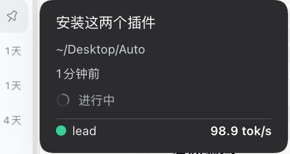
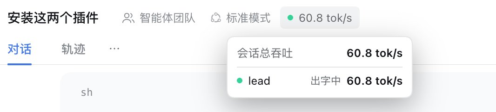
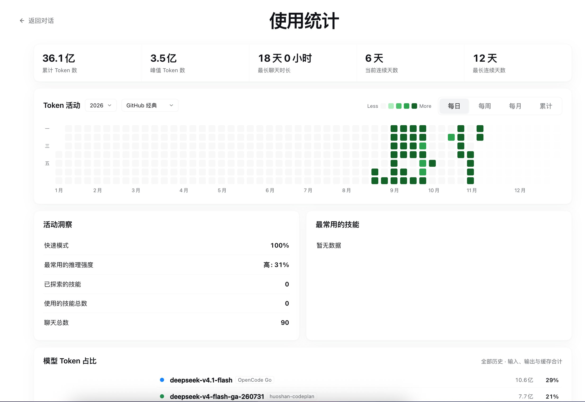

# dsh-token-board

[English](README.en.md) | 简体中文

DSH Web 实时 Token 看板：不再用悬浮窗罗列所有会话，而是把吞吐数据放到「就在你眼前」的位置，
点击侧边栏底部的概况行还会打开完整的「使用统计」面板（Token 活动热力图、活动洞察、技能与模型占比）。

| 位置 | 内容 |
| --- | --- |
| 侧边栏底部、账号行上方 | 三根绿/蓝/黄柱状图（有活动时依次跳动，空闲时灰色静止）+ 概况「N 会话进行中，X tok/s」；侧边栏收起为窄条时只显示图标，悬停弹出概况气泡 |
| 会话列表 hover 卡片底部 | 该会话当前进行中的主 Agent 与子 Agent 的实时 tok/s，前面带纯色状态圆点 |
| 会话标题栏动作区末尾（「N 个后台任务」右侧） | 当前打开会话的**整体吞吐**（主 Agent + 全部子 Agent 合计）；悬停展开全部 Agent 明细（暂停或 0 也计入）。计数器**紧贴右侧**的折线图图标在会话活动时每秒记录一个速度点，悬停显示本会话全部速度历史（详见下文「速度历史曲线」） |
| 点击底部概况行 | 打开完整「使用统计」面板：累计/峰值 Token、最长聊天、连续天数、Token 活动热力图（可选年份与配色主题，主题来自 calendar-heatmap design tokens 的 8 套方案；默认当前年全年格子，未来日期置灰不可 hover；每日/每周/每月/累计）、活动洞察、最常用技能、模型 Token 占比（时间范围可选 24 小时内 / 7 天 / 30 天 / 全部，默认 24 小时内；每个模型标注提供方来源）；中文界面，自适应白天/黑夜 |

状态圆点沿用 dsh-token-hud 的语义，但使用本插件自己的纯色样式（无描边、无光晕）：

| 状态 | 颜色 |
| --- | --- |
| 出字中 streaming | 绿 `#34d399` |
| 等待模型 running | 黄 `#facc15` |
| 工具调用 tool | 蓝 `#60a5fa` |
| 重试等待 retrying | 橙 `#fb923c` |
| 空闲 idle | 灰 `#9aa0a6` |

## 界面截图：不同场景下的 Token 速度

**场景一：会话列表悬浮卡片** — 在侧边栏会话列表里把鼠标移到某个会话上，卡片底部会显示该会话当前进行中的主 Agent 与子 Agent 各自的实时 tok/s（下图中 `lead` 为 98.9 tok/s）。



**场景二：会话标题栏** — 打开某个会话后，标题栏动作区末尾（「N 个后台任务」右侧）显示本会话的整体吞吐（主 Agent + 全部子 Agent 合计）；鼠标悬停展开每个 Agent 的明细（下图中会话总吞吐 60.8 tok/s，`lead` 处于出字中）。



## 速度历史曲线（会话标题栏）

会话标题栏吞吐计数器**紧贴右侧**有一个折线图图标。客户端完全复用已有的 1s `/token-board/v1/stats` 轮询做**纯前端采样**：不新增请求、不落盘、不调用任何 LLM。

- 只有当前打开的会话**处于活动状态**（主/子 Agent 非空闲）时才记录；空闲的秒数不记录，曲线在空闲时段**断开**，而不是补 0；
- 每秒最多一个采样点；X 轴为时间，Y 轴为该会话整体吞吐（tok/s），曲线用 Catmull-Rom 转三次贝塞尔段**平滑**绘制；
- 历史只存在当前页面的内存里（每会话最多 7200 点，约 2 小时；刷新页面清空）；切换会话时各自的历史保留；
- 悬停/聚焦图标弹出面板，样式与吞吐悬浮面板一致，面板内每秒随轮询实时更新，显示采样数、峰值速度与时间轴。

## 安装 / 部署

要求：DeepSeek Harness Web profile（在 `0.2.2-alpha.2` 上开发并验证）、Node.js `^22.19.0 || >=24.0.0`。
插件无 npm 依赖、无构建步骤、无外部网络请求；数据全部留在本机。

**方式一：从打包文件安装（推荐分发给他人）**

```sh
# 把 dsh-token-board-0.1.0.tgz 拷到目标机器后：
dsh plugin --profile web add /绝对路径/dsh-token-board-0.1.0.tgz
# 重启 dsh web（若 profile 已启用 HMR 会自动挂载，否则重启后生效），刷新页面
```

**方式二：从目录安装（开发/本地链接）**

```sh
dsh plugin --profile web add link:/绝对路径/dsh-token-board
```

**方式三：Web 界面**：设置 → Plugins 页面安装本目录或 tgz。

安装后侧边栏底部账号行上方出现概况行；宿主只读端点：

- `GET /token-board/v1/stats` — 实时各 Agent 吞吐（内部轮询）
- `GET /token-board/v1/usage?from&to&timeZone` — 使用统计快照（面板用）

首次打开统计面板时会在后台建立本地索引（大历史约 10 秒级，面板不阻塞、先显示部分数据并自动补全），
索引文件位于 `$DSH_HOME/token-board/usage-index.json`，可随时删除以重建。

卸载：`dsh plugin --profile web remove dsh-token-board`。

## 使用统计面板

点击侧边栏底部（账号行上方）的「N 会话进行中，X tok/s」概况行即可打开「使用统计」面板，
右上角「← 返回对话」或 Esc 返回。统计口径与界面参考
[Zhang6177/dsh-token-usage-board](https://github.com/Zhang6177/dsh-token-usage-board) 的
「Usage Stats」页面（只复刻其总体统计 UI，不含调用明细/导出/过滤等额外功能），数据同样来自本机会话日志。

Host 侧通过 `sessionQuery` 读取会话日志并按会话缓存摘要到 `$DSH_HOME/token-board/usage-index.json`
（进程内 30s 刷新、只增量读取新会话与当前活跃会话）。端点采用 stale-while-revalidate：
打开面板永远先返回内存里的上次结果（毫秒级），索引/刷新全部在后台进行，不会阻塞页面；
面板在 `indexReady:false` 时自动短轮询补全。首次安装无缓存时先显示部分/空数据，
后台建立索引（约 10 秒级）完成后自动更新。
只读端点：`GET /token-board/v1/usage?from&to&timeZone`。

「模型 Token 占比」右上角提供时间范围下拉框：**24 小时内**（默认，按当前时刻向前滚 24 小时）、**7 天**、**30 天**、**全部**。Host 在一次快照里按 assistant 活动的精确时间戳一并聚合 24h / 7d / 30d 三个滚动窗口，切换下拉只重绘饼图、不发起新请求。升级后 host 半边需要重启 `dsh web` 才会加载新的聚合代码；在重启之前，7 天/30 天/全部仍精确，24 小时内按日桶估算（今天 + 昨天落在窗口内的比例）。

面板全貌（示例数据）：



## 数据来源

Host 半边监听所有会话的 `session/event` 与（新版宿主的）逐 chunk 广播
`agent/assistant-stream`，用滚动窗口按字符数估算输出速度（中文 ≈1 tok/字，英文 ≈4 字符/tok），
并在 `assistant/message` 携带 provider usage 时校正为精确值。子 Agent 通过会话头部的
`parentSession` / `origin` / `delegationDepth` 归属到父会话，标题栏与 hover 卡片按「自身 + 全部后代」
聚合。纯内存、零持久化、不写会话日志。模型占比的 24h/7d/30d 滚动窗口同样由 host 按活动时间戳聚合、随 `/usage` 快照返回。
标题栏的速度历史曲线同样只在浏览器内存中累积（每秒 1 个活动采样点），
不发额外请求、不落盘，也不参与任何 LLM 调用。

## 配置（可选，cordis.patch.yml）

> 客户端固定轮询 `/token-board/v1/stats`；`apiPath` 如需修改必须同时改 `lib/client.js`，否则三个界面都取不到数。

```yaml
- id: token-board
  config:
    apiPath: /token-board/v1   # 只读端点前缀（固定，客户端硬编码同值）
    windowMs: 5000             # 速度滚动窗口
    charsPerToken: 4           # 非 CJK 每 token 字符数
    cjkTokensPerChar: 1        # 每个 CJK 字符的 token 数
    idleTtlMs: 180000          # 空闲 Agent 的保留时长
```

## 已知限制

- 速度是流式字符估算值（约 10% 级误差），provider 上报 usage 后校正。
- Host 重启后累计值清零；空闲超过 `idleTtlMs` 的 Agent 从明细中消失。
- 标题栏吞吐对「打开中的会话」生效；没有会话打开时该位置不显示。

## 测试

测试依赖 DSH 源码 checkout 里的 jsdom/react（`DSH_CHECKOUT` 或默认路径），因此从源码工作区运行；
打包安装（`files` 不含 `test/`）不带测试。

```sh
node test/test-host.mjs     # host 逻辑：估算/状态机/谱系/窗口有界/HTTP
node test/test-usage.mjs    # 使用统计聚合：totals/streak/热力图/模型/技能/缓存/参数校验
node test/test-client.mjs   # client 冒烟：模块加载、四个插槽、三个实时组件 + 使用统计面板
```

## License

MIT
